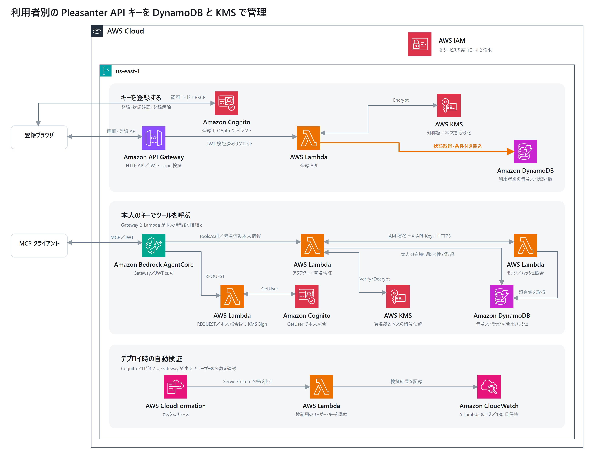

# AgentCore Gateway で利用者別の API キーを扱う検証

Cognito で認証した利用者の Pleasanter API キーを、KMS で暗号化して DynamoDB に保存するサンプルです。AgentCore Gateway の MCP アダプターは、認証済みの利用者に対応するキーだけを復号し、Pleasanter を模した `whoami` ツールを呼び出します。



[AWS 構成図・設計](docs/architecture.md) · [スタックのリソース一覧](docs/stack-resources.md) · [実環境の検証報告](docs/verification.md)

| 経路 | 処理 |
| --- | --- |
| ブラウザ → API Gateway → 登録 Lambda | Cognito の認可コードと PKCE でログイン。ルートごとに scope を検証し、キーを暗号化して登録する。登録状態の確認では復号しない。 |
| MCP クライアント → AgentCore Gateway → Lambda | インターセプターが Cognito で本人を確認して署名。アダプターが署名を検証し、`iss` と `sub` から項目を特定する。 |
| アダプター → モック MCP | DynamoDB を強い整合性で読み、対称 KMS 鍵で復号。IAM 認証付き Lambda Function URL に `X-API-Key` を付けて送る。 |

登録 Lambda は暗号化、アダプターは復号の権限を持ちます。暗号化コンテキストに用途と利用者の主キーを含めます。共有実行ロールで利用者を分離する境界は、認証済みの情報からサーバー側で項目を選ぶ処理です。

更新・解除は読み取った版を条件に書き込み、競合時は HTTP 409 を返します。解除すると暗号文を持たない無効行が残り、以後の取得でキーを使えなくなります。実行中の呼び出しで取得済みのキーや、Pleasanter 側のキーの有効性は影響を受けません。

このスタックはダミーキーでの検証用です。Cognito のローカルユーザー2人とモックを作成します。ログは180日保持に設定し、スタック削除時にはテーブルとロググループも削除します。KMS 鍵は7日間の削除待ちに入ります。

## 実行

Node.js 22 以降、Python 3.12、AWS CLI、対象アカウントの `us-east-1` で CDK のブートストラップ済み環境とデプロイ権限が必要です。認証には、利用する AWS CLI プロファイルを指定してください。

```text
npm ci
python -m pip install -r requirements-dev.txt
python -m unittest -v
npm run synth
aws sts get-caller-identity --profile DEPLOY_PROFILE --region us-east-1
npx cdk diff --profile DEPLOY_PROFILE
npx cdk deploy --profile DEPLOY_PROFILE
```

デプロイ時に検証 Lambda がダミーの API キーと Cognito パスワードを生成し、匿名拒否、利用者の分離、誤キー・無効キーの拒否、競合検知、再登録を確認します。検証が再実行される更新では、2人のパスワードと登録内容がリセットされます。

- `Verification` 出力と検証 Lambda の CloudWatch ログで合否を確認します。
- `RegistrationUrl` で登録画面を開けます。手動ログインには、管理者による検証ユーザーのパスワード設定が必要です。
- 外部 MCP クライアントで OAuth を使う場合は、synth 前に `PROBE_CALLBACK_URL` をそのクライアントのコールバック URL に設定します。
- 作業が終わったら、必要なログを先に保存し、`npx cdk destroy --profile DEPLOY_PROFILE` で検証環境を削除します。

## 実環境で確認した範囲

2026年11月10日、同じ構成の検証スタックを `us-east-1` にデプロイしました。Cognito の2ユーザーで MCP のツール一覧と呼び出しを確認し、利用者分離、予約引数の置き換え、誤キー・無効キーの拒否、古い版での更新拒否、再登録が合格しました。登録画面の HTTP 200 と未認証の状態取得に対する HTTP 401 も確認しました。登録ハンドラーはローカルテストで確認し、ブラウザでログインして行う登録操作は未検証です。
