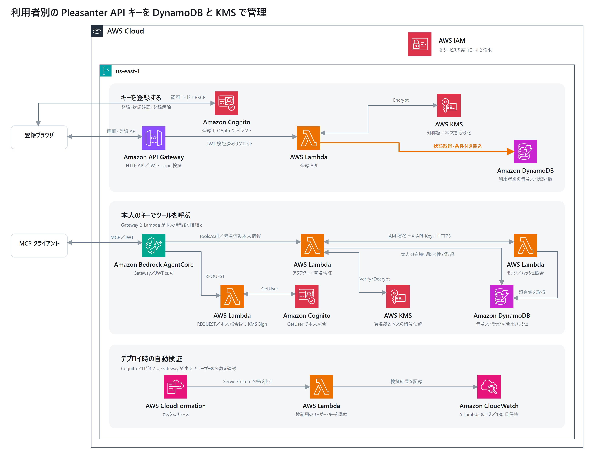

# Cognito と MCP Gateway の認証・キー保管設計

[拡大用 SVG](images/architecture.svg) · [実環境の検証結果](verification.md) · [スタックのリソース一覧](stack-resources.md)

このサンプルは Cognito の検証ユーザー2人が、利用者別のキーで Pleasanter モックを呼べることを確かめる。DynamoDB と対称 KMS 鍵で利用者のキーを管理し、登録画面を同じスタックに置く。接続先は固定のモック `whoami`。

## 登録・取得

| 経路 | 実装 |
| --- | --- |
| 登録ブラウザ → Cognito | 登録専用の公開クライアントで認可コード＋PKCE。Cognito のローカルユーザーを使う。 |
| ブラウザ → API Gateway → 登録 Lambda | HTTP API が JWT とルートごとの scope を検証。Lambda も発行元、クライアント、audience、access token、`sub` を確認する。 |
| 登録 Lambda → KMS・DynamoDB | Lambda が本文を KMS で暗号化し、受け取った暗号文をオンデマンドテーブルに保存する。状態照会は属性を投影し、暗号文を取得しない。 |
| MCP クライアント → Gateway → インターセプター | Gateway が専用クライアントの JWT を認可。インターセプターは Cognito GetUser の `sub` を照合し、有効期限30秒の本人情報に KMS で署名する。予約引数はインターセプターが生成する。 |
| Gateway／インターセプター → アダプター | `tools/call` は Gateway から、`tools/list` はインターセプターからアダプターを呼ぶ。アダプターは署名、発行元、期限、メソッドを検証する。一覧は固定で、キー取得・復号は呼び出し時に行う。 |
| アダプター → DynamoDB・KMS → モック | 強い整合性で本人の項目を読み、対称鍵で復号する。IAM 認証付き Function URL に `X-API-Key` を送る。モックは別の項目に保存したダミーキーのハッシュと照合する。 |

図では同じ Cognito プール、DynamoDB テーブル、対称 KMS 鍵を経路ごとに再掲した。署名用 KMS 鍵は別鍵。CloudFormation のカスタムリソースと検証 Lambda はデプロイ時に動作する。

## 保存形式と競合制御

主キーは `user#SHA256(iss + "\n" + sub)`。項目には `state`、`revision`、`updatedAt` と、登録中のみバイナリの `ciphertext` を持つ。KMS の暗号化コンテキストに用途と主キーを入れ、別利用者の項目に暗号文を移しても同じ条件で復号できないようにする。

登録と解除は、読み取った版を条件に項目を置き換える。未登録のときは項目が存在しないことを条件とする。競合時は HTTP 409。解除時は暗号文なしの無効行を残す。解除後の読み取りは復号しない。先に取得済みのキーを使う処理の中断と、Pleasanter 側のキーの失効は別の操作。

## 実行ロールの境界

| 実行主体 | 主な権限 |
| --- | --- |
| 登録 Lambda | 利用者項目の GetItem／PutItem、対称鍵で Encrypt |
| MCP アダプター | 利用者項目の GetItem、署名鍵で Verify、対称鍵で Decrypt、モック URL の IAM 呼び出し |
| インターセプター | 署名鍵で Sign、一覧処理用のアダプター呼び出し |
| モック | 照合用の `mock#` 項目の GetItem |
| 検証 Lambda | テストパスワード設定、ダミー項目と照合値の準備、対称鍵で Encrypt |

DynamoDB の IAM 条件は項目の名前空間、KMS の IAM 条件は鍵と暗号化コンテキストを絞る。共有実行ロールを使うため、個人単位のアクセス境界は検証済みの本人情報から主キーを算出する処理が担う。

実装根拠は [IaC](../build.py)、[登録処理](../registration.py)、[キー保管](../key_store.py)、[MCP 中継](../handlers.py)。Entra ID、実 Pleasanter、署名の一回限りの使用は本検証の範囲外。
