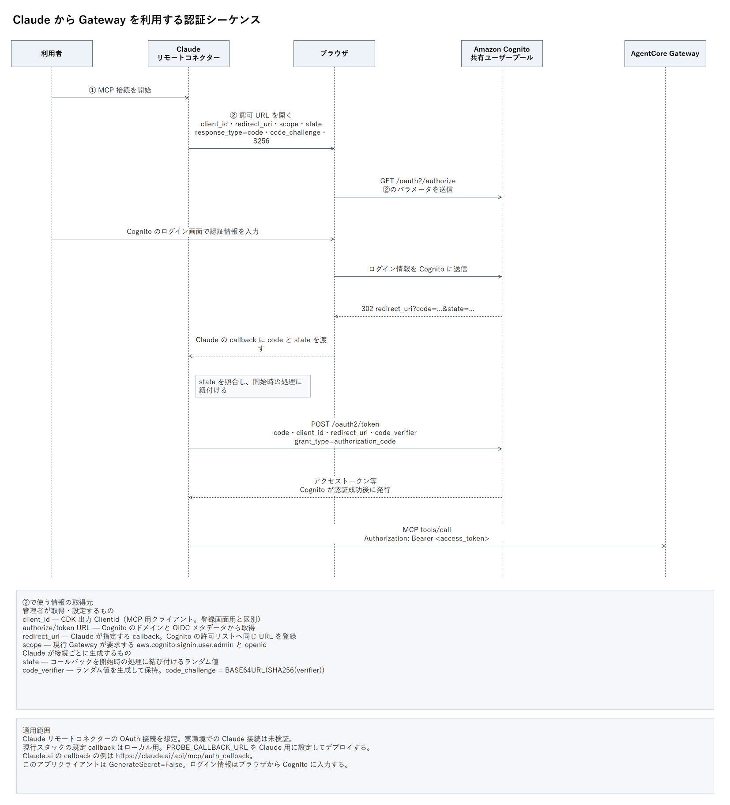
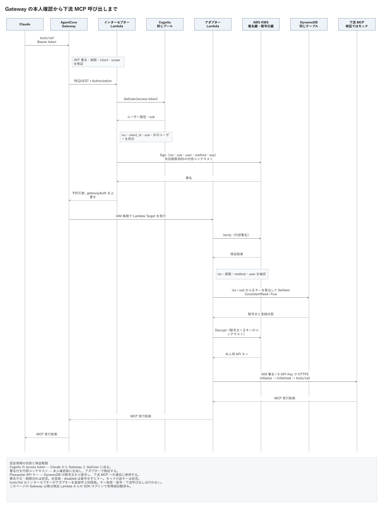

# Claude と Gateway の認証シーケンス

MCP クライアントは Claude のリモートコネクターを想定する。ブラウザでのログインから Gateway にアクセストークンを送るまでと、Gateway 以降の処理を2ページに分けた。

[編集可能な draw.io（2ページ）](images/gateway-auth-sequence.drawio)

## ログインとトークン取得

前のシーケンス図の②は、Claude が認可用 URL を組み立ててブラウザで開く処理に相当する。その直後にブラウザが Cognito の `/oauth2/authorize` にアクセスする。

| 送信情報 | 取得・生成する方法 |
| --- | --- |
| `client_id` | 管理者が CDK 出力の `ClientId` または Cognito の MCP 用アプリクライアントから取得し、Claude の OAuth クライアント設定へ入力する。登録画面用クライアントと区別する。 |
| `redirect_uri` | Claude の指定するコールバック URL を使い、Cognito の許可済みコールバック URL に完全一致で登録する。Claude.ai の例は `https://claude.ai/api/mcp/auth_callback`。 |
| 認可・トークンエンドポイント | Cognito ドメインにある `/oauth2/authorize` と `/oauth2/token`。OIDC メタデータの `authorization_endpoint` と `token_endpoint` で確認する。接続先設定や認証サーバーのメタデータからクライアントが利用する。 |
| `scope` | 現行コードでは `openid aws.cognito.signin.user.admin` を許可し、Gateway は後者を要求する。管理者が許可設定を揃える。 |
| `response_type=code` | 認可コードフローを使う指定。 |
| `state` | Claude が接続開始時にランダム値を生成・保持する。コールバックで同じ値か確認する。 |
| `code_challenge`・`code_challenge_method=S256` | Claude がランダムな `code_verifier` を生成して保持し、その SHA-256 を Base64URL エンコードして challenge にする。 |

ユーザー名やパスワードは、利用者がブラウザ上の Cognito ログイン画面に入力する。認証に成功すると Cognito が認可コードを発行し、ブラウザを Claude のコールバックへ戻す。Claude は認可コードと保持した `code_verifier` をトークンエンドポイントに送り、アクセストークンを受け取る。現行の MCP 用アプリクライアントは `GenerateSecret=False`。

現行スタックの既定 callback はローカル用なので、Claude 接続では `PROBE_CALLBACK_URL` を Claude 用に設定してデプロイする。この資料の Claude OAuth 部分は想定フローで、実環境では未検証。Client ID の設定、ディスカバリー、scope と必要に応じた resource パラメータなど、実際の Claude 接続条件は接続試験で確認する。

## Gateway と本人用キーの使用

Gateway は MCP 用クライアントの JWT を検証する。インターセプターが同じ Cognito プールの GetUser を使い、確認した本人情報へ KMS で署名する。アダプターは署名と期限を検証して、検証済みの `iss` と `sub` から DynamoDB の主キーを計算し、本人の API キーを復号する。

図の Cognito は共有プール1つ、DynamoDB は共有テーブル1つ。署名用と本文暗号化用の KMS 鍵は別鍵。下流は検証用モックで、IAM 署名と API キーのハッシュを照合する。Gateway 以降は検証 Lambda が Cognito SDK でログインして試験した。

## 根拠

- [Claude のリモート MCP コネクター設定](https://support.claude.com/en/articles/11175166-get-started-with-custom-connectors-using-remote-mcp)
- [AWS の Claude と Gateway の接続例](https://docs.aws.amazon.com/bedrock-agentcore/latest/devguide/gateway-target-connector-web-search-tool.html)
- [Cognito の認可エンドポイント](https://docs.aws.amazon.com/cognito/latest/developerguide/authorization-endpoint.html)
- [Cognito のトークンエンドポイント](https://docs.aws.amazon.com/cognito/latest/developerguide/token-endpoint.html)
- [Cognito の PKCE](https://docs.aws.amazon.com/cognito/latest/developerguide/using-pkce-in-authorization-code.html)

図は draw.io Desktop 32.6.10 で PNG 出力した。UML の参加者・メッセージ・説明は個別の図形として編集できる。`images/build_auth_sequence.py` から draw.io 正本を再生成できる。
